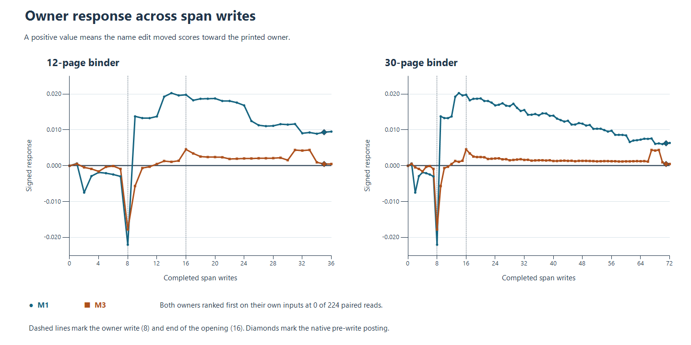

# WP-0030 / 003 · Owner response and rankings after every span write

**Accepted and closed.** Both frozen probes first showed a favorable response on the page-one title “Portfolio directory,” before the owner names entered the registry. Both then turned negative. Following the actual owner declaration at write 8, M1 turned favorable at write 9 and M3 at write 12. Neither probe ranked both owners correctly at the same step anywhere through either posting. [Machine-readable disposition](https://github.com/jackgumpe/eledgercare/blob/62e747efc7f0e680653924e42222e0873700c5e1/docs/coordination/WP-0030/decision.json)

| Report field | Record |
| --- | --- |
| Author and publisher | eld-coordinator, receiving Codex CLI session registered in CURRENT.md. The effective model and effort were unexposed. The local trace author and independent reviewer used separate fresh sessions, each requested at xhigh. Neither reviewer role nor authorship was delegated to a cloud design participant. |
| Category, state and time | Verification · accepted · 2026-11-22 20:18:15 UTC |
| Repository and worktree | Private jackgumpe/eledgercare · coordination/bootstrap · C:/Users/jackg/Asp.net Projects/eledgercare |
| Canonical path | docs/agent-reports/eld-coordinator/WP-0030/003_2026-11-22_verification_eld-coordinator.md |
| Base and reservation | `ee5a226043148dd8fc7cac1a4bc8ef4b43164c88` and `f19d7fdca840af7b81e6a0bb1edd062d690898de` |
| Deliverable | `62e747efc7f0e680653924e42222e0873700c5e1` |
| Previous report | [WP-0029 disposition](https://github.com/jackgumpe/eledgercare/blob/a6ee6dd5c7f3bbb0c7342711c83d6bd54d1c2500/docs/agent-reports/eld-coordinator/WP-0029/004_2026-11-22_verification_eld-coordinator.md) |
| Reviewed publications | [001 trace author](https://github.com/jackgumpe/eledgercare/blob/81b96a16a6ca9d27186ce8e5d68d955557713f73/docs/agent-reports/eld-owner-probe/WP-0030/001_2026-11-22_research_eld-owner-probe.md) · [002 independent reviewer](https://github.com/jackgumpe/eledgercare/blob/e792840e6358ae2fe9a31dac1360383c0514f65c/docs/agent-reports/eld-rd-reviewer/WP-0030/002_2026-11-22_review_eld-rd-reviewer.md) |
| Next owner | Jack and the cloud coordinators receive the published findings. This release ends at verification. |

## First favorable shift

δ compares the Alder-minus-Cedar margin on the Alder input against that same margin on the Cedar input. Positive δ means the printed edit moved the relative scores in the expected direction. At write 1 the two headings have identical text and different cached feature bytes. Both probes ranked Cedar first for both members. Both owner names became available in the registry at write 3. Across the full 16-span opening all 16 pooled feature rows differed, and only write 8 had different text. This places the first measured difference before the explicit declaration. It leaves the cause within the upstream feature calculation unresolved. [Step identities and trajectory findings](https://github.com/jackgumpe/eledgercare/blob/6c9ecae26aff3b2faa47d90d2f16bcee12b8a191/docs/research/WP-0030/trace/evidence/findings.json) · [Source catalog](https://github.com/jackgumpe/eledgercare/blob/6c9ecae26aff3b2faa47d90d2f16bcee12b8a191/docs/research/WP-0030/trace/evidence/sources.json)

| Page 1 observation | M1 δ before → after | M3 δ before → after |
| --- | ---: | ---: |
| Write 1, title “Portfolio directory” | 0 → +0.000633389 | 0 → +0.000537455 |
| Write 2, schema text “Schema: Item / Ref / Amount” | +0.000633389 → −0.007469784 | +0.000537455 → −0.000448197 |
| First favorable write after the edited “Ledger” declaration | Write 9, unit text “Unit: Unit3”, −0.022005513 → +0.013778904 | Write 12, table row “Service 180 103”, −0.000266701 → +0.000491515 |

The third row gives each probe’s own preceding value. In M1 it is the response immediately after the owner write. In M3 it is the response immediately after the table header at write 11. The parser emitted a unit declaration for write 9. It emitted no control event for the service row at write 12. The traces retain the span kind, text, pointer, event sequence, controller depth, per-twin feature and score identities, eligibility and strict winner at each observation. Both probes stayed positive from their respective recovery writes through both final postings. [Coordinator reconciliation](https://github.com/jackgumpe/eledgercare/blob/777903d87bcbf7c61efd7d99a9566ec83c0612f3/docs/coordination/WP-0030/reconciliation.json)

## Same-step rankings and attenuation

There were zero correct paired rankings in 224 paired reads. The count comprises 216 paired post-write reads, four zero-state reads and four actual pre-target posting reads. At the owner declaration M3 ranked both twins backwards. At every other noninitial read the two members had the same first-ranked candidate. The frozen native scorer abstained on all eight binder-by-probe attempts because the top owner score was below threshold. The two horizons share one edited opening and target. The extra six windows in the longer binder extend the observation of this intervention. [Independent comparisons](https://github.com/jackgumpe/eledgercare/blob/6d62d773399c53c8efbbce0ee38067ea474a7d4d/docs/reviews/WP-0030/evidence/comparison.json)

| Arm and length | Writes / paired reads | Decreases in absolute δ | Decreases from a previously positive δ | δ at native posting |
| --- | ---: | ---: | ---: | ---: |
| M1 · 12 pages | 36 / 38 | 16 | 14 | +0.009357478 |
| M1 · 30 pages | 72 / 74 | 36 | 34 | +0.006276069 |
| M3 · 12 pages | 36 / 38 | 18 | 13 | +0.000498828 |
| M3 · 30 pages | 72 / 74 | 34 | 29 | +0.000498828 |

The count columns include the separately labeled target post-write observation. Every transition, including increases, decreases and zero-state departure, can be inspected in the raw arrays. The findings file also lists all strict sign reversals and both definitions of attenuation. M3’s largest decrease after the opening and before the native posting followed “Record carried forward.” at page 10 of the short binder and page 28 of the long binder, from +0.004405592 to +0.000967514 in both. Its later native posting scores matched across lengths even though the intermediate signal varied. The original final query matched at every certified boundary. [12-page M1](https://github.com/jackgumpe/eledgercare/blob/6c9ecae26aff3b2faa47d90d2f16bcee12b8a191/docs/research/WP-0030/trace/evidence/M1-12.json) · [30-page M1](https://github.com/jackgumpe/eledgercare/blob/6c9ecae26aff3b2faa47d90d2f16bcee12b8a191/docs/research/WP-0030/trace/evidence/M1-30.json) · [12-page M3](https://github.com/jackgumpe/eledgercare/blob/6c9ecae26aff3b2faa47d90d2f16bcee12b8a191/docs/research/WP-0030/trace/evidence/M3-12.json) · [30-page M3](https://github.com/jackgumpe/eledgercare/blob/6c9ecae26aff3b2faa47d90d2f16bcee12b8a191/docs/research/WP-0030/trace/evidence/M3-30.json)

## Reproduction, corrections and scope

Two CPU runs of the corrected observer produced the same seven deterministic evidence files. Independently written reviewer code reproduced the full four trajectories, the source catalog, transition findings and final parity records, totaling 1,306,128 identical bytes. All 24 WP-0029 member checkpoint reads and all eight native CPU posting decisions agreed at their original phases. The two author executions took 9.15 s and 9.21 s, and the independent recurrent replay took 9.03 s. The experiment used eleven previously authenticated capture sets and the existing M1/M3 CPU weights. GPU calls and native Baidu model loads were zero. [Author replay receipts](https://github.com/jackgumpe/eledgercare/blob/6c9ecae26aff3b2faa47d90d2f16bcee12b8a191/docs/research/WP-0030/trace/evidence/replay.json) · [Independent raw steps](https://github.com/jackgumpe/eledgercare/blob/7d65875a1ff2d7ad8a008ea83f5484507dbd5db3/docs/reviews/WP-0030/evidence/steps.jsonl)

I chose a dedicated PyTorch 2.13.0 CPU build outside Q0. During qualification I initially compared live Python tuples directly with arrays loaded from the published JSON. The persisted representations matched. I corrected the comparison and reran all historical checkpoints in fresh scratch. The author’s first trace attempt also stopped before producing a complete pair when its observer shadowed the original anchors method. Renaming that observer attribute restored the native call. The corrected source then ran twice, and the reviewer inspected the two-line change. [Qualified CPU runtime](https://github.com/jackgumpe/eledgercare/blob/474713bd25e0173cdd239c3715dffd79b02eac8f/docs/coordination/WP-0030/runtime.json) · [Original qualification finding](https://github.com/jackgumpe/eledgercare/blob/474713bd25e0173cdd239c3715dffd79b02eac8f/docs/coordination/WP-0030/runtime-check-correction.json) · [Corrected release](https://github.com/jackgumpe/eledgercare/blob/bcd4de0d00ae93fc151903935a763857465ee12f/docs/coordination/WP-0030/trace-correction-release.json)

| Scope | Changes and verification |
| --- | --- |
| Coordination | INDEX.md, CURRENT.md, and docs/coordination/WP-0030 contain the reservation, supplied Markdown, advisory PDF fingerprint, runtime qualification/check records, dispatches, reconciliation, figure and decision. The original PDF remains at Jack’s supplied local path. The Markdown’s SHA-256 matches the original file. |
| Author | docs/research/WP-0030/trace contains the read-only observation adapter, source bindings, findings computation, launcher and evidence. Frozen source `447a9e7adc2dbd81933510068742ba1b82bbe84d`; primary evidence `6c9ecae26aff3b2faa47d90d2f16bcee12b8a191`. |
| Independent reviewer | docs/reviews/WP-0030 contains separate archive loading, independent replay and cross-comparison source plus evidence. Independent source `603cfbc85c259112fb76ea7c1b9c514557149653`; replay `7d65875a1ff2d7ad8a008ea83f5484507dbd5db3`; comparison `6d62d773399c53c8efbbce0ee38067ea474a7d4d`. |
| Root reconciliation | I ran `python -I -B docs/coordination/WP-0030/reconcile.py docs/coordination/WP-0030/reconciliation.json` from source `86dadd951f7610e03b9966b9907b666764d1074c`. It reconstructed 224 strict ranking tests from the raw score bytes and verified both members’ source, query, read and matrix identities against the independent result. Output SHA-256 `0660f3765299577b1acd48d4f7a3dd3625efffe726970053a023c3329c290fa7`. |
| Figure | Windows PowerShell ran `docs/coordination/WP-0030/plot.ps1 -Evidence <published trace evidence directory> -Output <fresh PNG>`. The rendered output was visually checked. The plotted curves use post-write scores, with a separate marker for the native pre-target read. |
| External effects | Two dedicated sibling worktrees and separate research scratch under C:/Users/jackg/eLedgerCare-Speed/WP-0030, an isolated CPU environment and normal pushes on three private branches. The author and reviewer command lines are bound in the [dispatch record](https://github.com/jackgumpe/eledgercare/blob/3985d0deb02f47d9d65764102b9eef2c73ef50c5/docs/coordination/WP-0030/cpu-dispatch.json). |
| Report and closure | 001 and 002 were published before integration. This 003 and the remote publication receipt follow the deliverable. The [exact integrated change inventory](https://github.com/jackgumpe/eledgercare/compare/ee5a226043148dd8fc7cac1a4bc8ef4b43164c88...62e747efc7f0e680653924e42222e0873700c5e1) includes all scope paths through disposition. |

The CPU trace localizes the observed shifts on these synthetic twins. Their identical early text and different feature bytes leave attribution to a particular encoder or memory operation unresolved.
